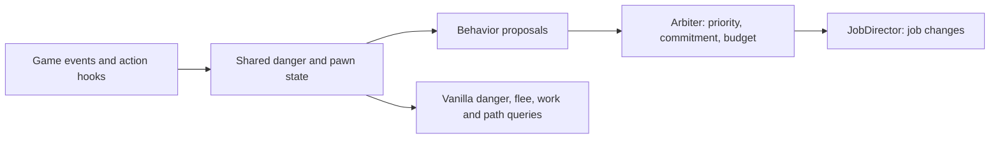

# Rim Smart Framework

[](https://github.com/Tawitsy/Rim-Smart-Framework/releases)
[](#installation)
[](https://github.com/pardeike/HarmonyRimWorld)
[](LICENSE)
[](https://ko-fi.com/tawitsy)

**Less babysitting. More time to run your colony.**

Rim Smart Framework adds coordinated combat, survival, and everyday work behaviors to RimWorld. Colonists react to active shooting, avoid dangerous work, seek care for critical bleeding, and make practical choices about meals, hauling, and work areas.

The framework shares danger information with vanilla decisions and coordinates its own actions through a central job director. Its reasoning runs on game events and existing decision points, without a separate per-tick polling loop.


**Current version: 1.3.0.** Tested on RimWorld **1.6** and the **1.7 unstable branch**. See the [changelog](CHANGELOG.md) for release details and test coverage.

[Download](https://github.com/Tawitsy/Rim-Smart-Framework/releases) · [Features](#what-it-does) · [Installation](#installation) · [Compatibility](#mod-compatibility) · [Report a bug](#bug-reports) · [Developer reference](#for-developers)

## What it does

### Combat and survival

- **Firing discipline:** checks allies in a pawn's shot line and blast area, holds unsafe shots, and can look for a sidestep. Explosive safety also considers the shooter and nearby explosive objects.
- **Threat-aware movement:** shares active shooter danger with vanilla flee and work decisions. Path costs encourage undrafted colonists to take a detour around firing zones when one is practical.
- **Cover and kiting:** colonists set to **Attack** can seek cover or step back from approaching melee attackers. Colonists set to **Flee** use vanilla flee behavior; **Ignore** retains that chosen response.
- **Explosion response:** checks whether an explosive can harm the pawn and seeks a destination outside its blast, including large blasts.
- **Medical urgency:** critically bleeding colonists can interrupt routine work to seek a bed or self-tend. Early rescue lets helpers carry eligible injured colonists to bed before they collapse.
- **Environmental safety:** work checks account for fire, unsafe temperatures, and toxic fallout, including the pawn's toxic resistance. Predator hunting events can trigger an alert and retreat.
- **Optional turret and mortar discipline:** holds automatic fire when an ally is in the line or blast. This option is **off by default**; manually assigned turret targets bypass this check.

### Everyday work and base care

- Clean nearby filth before cooking or surgery, and prefer food that is closer to spoiling.
- Prepare for long trips by addressing hunger or rest, and pick up suitable items along the route.
- Filter routine work at dangerous targets, including cell jobs such as sowing and roofing.
- Skip outdoor cleaning when rain is already washing that type of filth away.
- Prefer nearby work and reduce redundant task selection, with configurable delegation and room focus.
- Keep storage and item drops off door tiles where the placement hooks apply; move idle destinations out of doorways.
- Favor construction positions with an exit and unroofed positions when deconstructing supports. These are local positioning checks, not a full roof-collapse simulation.
- Avoid disturbing sleeping colonists through work and idle-destination checks.

### Mental breaks

- Tantrums avoid recognized explosives and storage containing them.
- Choose which **Major** and **Extreme** mental breaks your colonists can receive, including modded breaks in the settings list. All are allowed by default.

## Installation

1. Install [Harmony](https://github.com/pardeike/HarmonyRimWorld).
2. Download the mod package from [Releases](https://github.com/Tawitsy/Rim-Smart-Framework/releases) and extract it into your RimWorld `Mods` folder.
3. Check that the folder contains `About/About.xml`, `1.6/Assemblies`, and `1.7/Assemblies`, without an extra nested copy of the mod folder.
4. Enable **Harmony** and **Rim Smart Framework**, with Harmony loaded first, then restart RimWorld.
5. Open **Options → Mod Settings → Rim Smart Framework** to configure features and inspect detected mods.

The mod supports adding it to an existing save. Keep a backup when changing a save's mod list. Release packages are the simplest installation route; source builds are described [below](#building-from-source).

## Settings and player control

The five modules—**Combat, Survival, Work, Structure, and Mind**—can be enabled separately. Module changes require a restart: a disabled module's categorized patches are not installed, while shared core hooks remain available to the framework.

Individual settings control firing discipline, cover, work filtering, hauling, medical care, mental breaks, and other behaviors. Important defaults and exceptions:

- **Drafted assistance is enabled by default.** The “Assist drafted pawns with tactical fallback” setting permits limited assistance, including kiting and blast evacuation. Direct player movement orders are protected. Turn this setting off if you do not want these drafted movement assists.
- **Forced fire is allowed by default.** The “Allow forced fire when drafted” option lets a drafted pawn's forced firing order bypass the pawn firing-safety check.
- **Turret and mortar discipline is disabled by default.** Enable it separately from pawn firing discipline.
- **Threat routing uses a path penalty.** It favors detours rather than making dangerous cells impassable; a route can still cross danger when alternatives are too costly or unavailable.
- **Advanced controls require Development Mode.** They expose threat memory, reach bounds, cache timing, evaluation budgets, path penalties, and a threat overlay. The defaults are the values used for the reported tests.

## Mod compatibility

The compatibility registry contains **26 profiles**. The **Detected mods** section in settings distinguishes three kinds of support:

| Integration | What RSF does |
| --- | --- |
| **While You're Up / Jobs of Opportunity — Yield** | Disables RSF's on-route hauling so the detected mod handles it. A setting lets you retain RSF's version. |
| **Common Sense — Adapter** | Leaves clean-before-work behavior to Common Sense when it is enabled there. |
| **Combat Extended — Adapter** | Integrates friendly-fire checks with CE's shot-line handling. |
| **Perspective Shift — Adapter** | Excludes the directly controlled avatar from autonomous steering. |
| **Dubs Bad Hygiene — Adapter** | Treats desperate bladder or thirst as a reason to leave shelter, alongside urgent vanilla needs. |
| **Other recognized mods — Tested alongside** | Records that they were tested together; this label does not mean a dedicated adapter or automatic feature handoff. |

The v1.3.0 test lists include **CAI 5000, Yayo's Combat 3, Smart Medicine, Simple Sidearms, Achtung!, Pick Up and Haul, Hospitality, Vanilla Expanded Framework, Vehicle Framework**, and others. The [changelog](CHANGELOG.md#v130) records the tested combinations.

Compatibility depends on the versions, settings, and features in use. These tests do not establish that every combination is conflict-free or that RSF replaces every feature of another mod. **Save Our Ship 2 and fog-of-war mods have not been tested.** RSF currently reads threat information from game data without respecting fog-of-war visibility.

## Performance and validation

RSF uses event hooks, shared per-map danger data, cached profiles, and evaluation budgets to limit repeated work. It still performs work when events and vanilla queries occur; event-driven does not mean zero CPU cost.

The [v1.3.0 release record](CHANGELOG.md#v130) reports:

| Check | Recorded result |
| --- | --- |
| Automated in-game suite | 62 tests passing on both RimWorld 1.6 and the 1.7 unstable branch |
| Colony stress runs | Two 3-day soaks and a 1-day dense raid soak, with no reported RSF errors, stuck pawns, or behavior oscillation |
| Mod lists | A 117-mod list including Combat Extended, plus a separate popular-mod list without CE |
| Benchmark scenario | 110 colonists and a 90-raider raid |
| Measured mod self-time | About **0.12 ms/tick** during normal work and **0.13–0.21 ms/tick** during the raid |

These timings measure the mod's own execution in the recorded scenario, not total game tick time or a guaranteed TPS gain. They are not a controlled comparison against a feature-equivalent collection of other mods.

## Current limits

- Shooter reach is an estimate bounded to **8–40 cells by default**, with line-of-sight checks and cached region danger. It is not an exact prediction of every projectile or modded ability.
- A wander destination can still be selected inside a firing zone even when the route attempts to avoid it.
- Long-range threats can require more than one vanilla flee step.
- Path detours, local construction checks, and firing discipline reduce specific risks; they do not guarantee a safe outcome in every layout.
- 1.7 coverage refers to the tested unstable branch. Later game updates require their own verification.

## Bug reports

Open a [GitHub issue](https://github.com/Tawitsy/Rim-Smart-Framework/issues) with:

- Your RimWorld and RSF versions, active mod list, and relevant RSF settings.
- What you expected, what happened, and steps to reproduce it.
- `Player.log`, plus a save or short clip if it helps reproduce the behavior.
- For pawn decision problems, the output of **Explain pawn decisions** if available.

To inspect a pawn, enable **Development Mode**, open **Debug Actions → Rim Smart Framework → Explain pawn decisions**, and select the pawn. The report includes its current job, commitment, cooldowns, map alert state, and recent recorded decisions. The Advanced settings also provide a threat overlay.

## For developers

### Execution model



The decision tiers are **PlayerOrder → VanillaEmergency → Survival → VanillaNeed → Tactical → Routine**, from highest to lowest priority. Interruption guards, commitments, and behavior cooldowns constrain proposals. Vanilla query filters also influence existing decisions without creating a separate job for every reaction.

| Source area | Responsibility |
| --- | --- |
| [Core](Source/SmartAIFramework/Core) | Event hooks, pawn state, tactical grid, threat map, path costs, and cached profiles |
| [Decisions](Source/SmartAIFramework/Decisions) | Proposals, arbitration, job changes, and decision diagnostics |
| [Modules](Source/SmartAIFramework/Modules) | Combat, Survival, Work, Structure, and Mind; categorized Harmony patch registration |
| [Compat](Source/SmartAIFramework/Compat) | Compatibility profiles and dedicated adapters |
| [API](Source/SmartAIFramework/API/SmartAIApi.cs) | Hazard registration, danger queries, target suppression, and utility score overrides |
| [SmartAISettings.cs](Source/SmartAIFramework/SmartAISettings.cs) | Feature defaults, saved settings, and configuration UI |

### Modder API

The public API exposes `RegisterHazard`, `ClearHazard`, `GetDanger`, `GetVerbProfile`, `GetThingProfile`, `TicksUntilBleedOut`, `SuppressTarget`, and paired `RegisterScoreOverride` / `UnregisterScoreOverride` methods. See [SmartAIApi.cs](Source/SmartAIFramework/API/SmartAIApi.cs) for current signatures.

For a custom object, add this extension inside its `ThingDef`:

```xml
<modExtensions>
  <li Class="SmartAIFramework.API.AIThreatExtension">
    <hazardRadius>6.5</hazardRadius>
    <dangerScore>80</dangerScore>
  </li>
</modExtensions>
```

This registers a hazard when the object spawns; `dangerScore` is converted into a grid weight rather than used as an exact cell-danger value. The extension requires RSF to be loaded, so optional integrations should conditionally apply their XML. For hazards that become active later, use the C# registration API and clear them when they end, before the source despawns.

### Building from source

The project targets **.NET Framework 4.7.2** (`net472`) and uses the .NET SDK. By default, NuGet supplies compile-time RimWorld 1.6 reference assemblies, Harmony, and .NET Framework reference assemblies:

```powershell
dotnet build "Source/SmartAIFramework/SmartAIFramework.csproj" -c Release
```

To compile against a local game installation, pass its managed assembly directory:

```powershell
dotnet build "Source/SmartAIFramework/SmartAIFramework.csproj" -c Release -p:RimWorldManaged="E:/SteamLibrary/steamapps/common/RimWorld/RimWorldWin64_Data/Managed"
```

**The build writes to `1.6/Assemblies` and copies the DLL to `1.7/Assemblies`.** Build in a separate checkout if the installed mod is in use. Harmony is supplied at runtime by the Harmony mod; do not bundle `0Harmony.dll` with RSF.

## Documentation, support, and license

The [GitHub Wiki](https://github.com/Tawitsy/Rim-Smart-Framework/wiki) contains additional guides: [Features](https://github.com/Tawitsy/Rim-Smart-Framework/wiki/Features), [Compatibility](https://github.com/Tawitsy/Rim-Smart-Framework/wiki/Compatibility), and [Modder API](https://github.com/Tawitsy/Rim-Smart-Framework/wiki/Modder-API).

Wiki languages: [English](https://github.com/Tawitsy/Rim-Smart-Framework/wiki) · [ไทย](https://github.com/Tawitsy/Rim-Smart-Framework/wiki/Home-TH) · [简体中文](https://github.com/Tawitsy/Rim-Smart-Framework/wiki/Home-ZH) · [日本語](https://github.com/Tawitsy/Rim-Smart-Framework/wiki/Home-JA) · [한국어](https://github.com/Tawitsy/Rim-Smart-Framework/wiki/Home-KO) · [Русский](https://github.com/Tawitsy/Rim-Smart-Framework/wiki/Home-RU). Non-English pages include AI-translated drafts; corrections are welcome.

Created by **Tawitsy**. Licensed under the [MIT License](LICENSE). If the mod helps your colony, you can support development on [Ko-fi](https://ko-fi.com/tawitsy).
