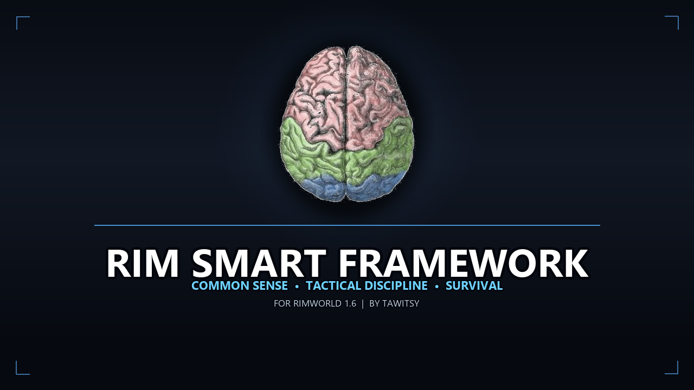

# Rim Smart Framework

[-blue.svg)](https://github.com/Tawitsy/Rim-Smart-Framework/releases)
[](https://rimworldgame.com/)
[](https://github.com/pardeike/HarmonyRimWorld)
[](https://github.com/CombatExtended-Continued/CombatExtended)
[](https://ko-fi.com/tawitsy)



> ⚠️ **Status: Experimental / Testing Phase (Beta v1.0.0)**  
> This framework is currently under active development and field testing for **RimWorld 1.6 & 1.7**. While verified against decompiled engine assemblies, edge-case adjustments are ongoing. Feedback, suggestions, and issue reports are warmly welcomed!

A lightweight cognitive framework that brings intuitive common sense, tactical discipline, and collaborative coordination to your colonists in **RimWorld 1.6 & 1.7**.

---

## Features

### Tactical Combat
* **Friendly Fire & Explosive Safety:** Colonists hold fire or sidestep if allies or high-value base assets are in the line of fire.
* **Tactical Fallback & Explosive Dodge:** Ranged fighters step back from approaching melee enemies and jump clear of armed explosives or hissing turrets before detonation.
* **Focus Fire & Priority Targeting:** Colonists coordinate fire on high-threat targets carrying heavy ordnance or enemies threatening allies.
* **Muzzle Discipline:** Moving pawns avoid walking across active firing lines.
* **Combat Extended Ready:** Seamless out-of-the-box compatibility.

### Collaborative Work & Daily Life
* **Proximity Precedence:** Nearby colonists take priority on local tasks rather than distant colonists trekking across the entire map.
* **Room-Centric Focus:** Colonists finish chores in their current workshop or room before heading outside.
* **Clean Workstations:** Cooks and doctors keep immediate prep areas tidy before beginning work.
* **FIFO Consumption:** Colonists prefer meals closest to spoiling first.
* **Comfort Seating:** Colonists look for nearby chairs and tables when eating.

### Base Safety & Survival
* **Clear Doorways:** Prevents dropped items, mined chunks, or outputs from jamming open security and freezer doors.
* **Builder Safety:** Builders stand in open positions to avoid trapping themselves behind new walls.
* **Emergency Triage:** Colonists suffering severe blood loss immediately prioritize medical treatment.
* **Fire Safety:** Colonists refuse to enter superheated inferno rooms without protection.
* **Predator Alarm:** Colonists retreat and sound an alert when targeted by predators.

---

## Building from Source

Requires the **.NET SDK** (targets `net472`):

```powershell
dotnet build "Source/SmartAIFramework/SmartAIFramework.csproj" -c Release
```

---

## Support & Contributions

* ☕ **[Support on Ko-fi](https://ko-fi.com/tawitsy)**

---

## License

This project is licensed under the MIT License - see the [LICENSE](LICENSE) file for details.
