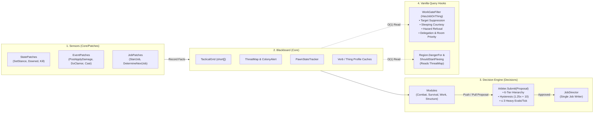
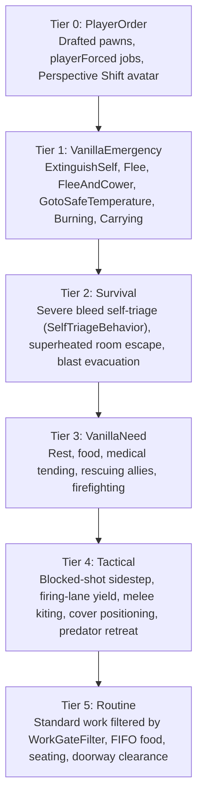

# Rim Smart Framework

[](https://github.com/Tawitsy/Rim-Smart-Framework/releases)
[](https://rimworldgame.com/)
[](https://github.com/pardeike/HarmonyRimWorld)
[](https://github.com/CombatExtended-Continued/CombatExtended)
[](https://github.com/Tawitsy/Rim-Smart-Framework/wiki)
[](https://ko-fi.com/tawitsy)


> ⚠️ **Status: Beta Testing**  
> This mod is currently in active beta testing for **RimWorld 1.6 & 1.7**. Edge cases are actively being tested and refined. Please report any bugs or feedback via the [Issues](https://github.com/Tawitsy/Rim-Smart-Framework/issues) tab.

An event-driven decision framework for **RimWorld 1.6 & 1.7** that coordinates player-faction pawn survival, tactical positioning, and work filtering without per-tick polling.

---

## 1. Architecture & Execution Pipeline

Instead of scanning pawns or cells on tick intervals, the framework executes strictly on **Harmony Event Hooks** and **Vanilla Decision Points**:



### Core Engineering Design
1. **Zero Tick Polling:** No `Tick()`, `TickRare()`, `CompTick()`, or `IsHashIntervalTick()`. All timestamps (`PawnStateTracker.Now`) are evaluated lazily when events fire. Measured mod self-time in benchmark runs with 110 colonists and a 90-raider raid is **~0.16 ms/tick** during normal work and **~0.30–0.50 ms/tick** during raids.
2. **Single Job Writer (`JobDirector`):** Behaviors and patches never call `StartJob` or `EndCurrentJob` directly. Every action is submitted as a `Proposal` to `Arbiter`, and only `JobDirector` mutates or vetoes pawn jobs.
3. **Shared Danger State (`ThreatMap`):** Active hostile shooters are tracked in `ThreatMap`. Vanilla's `Region.DangerFor` and `SelfDefenseUtility.ShouldStartFleeing` read this state so colonists set to *Flee* use vanilla's `FleeAndCower` and avoid routing work, food, or wandering trips into active shooter reach, while colonists set to *Attack* use cover and kiting tactics.
4. **Fault-Isolated Module Patching (`ModuleRegistry`):** Each module (`Combat`, `Survival`, `Work`, `Structure`) binds to its own `HarmonyPatchCategory`. Disabled modules apply zero patches on startup, and each patch class is applied individually so a broken target method disables only that specific patch class.

---

## 2. Decision Tier Hierarchy & Anti-Oscillation

Every `Proposal` carries a `DecisionTier` (`0` = highest priority, `5` = lowest). A proposal can never override a current job or pending proposal of the same or higher priority tier unless it passes commitment hysteresis:



* **Commitment Hysteresis (`Arbiter`):** When a proposal executes, the pawn commits for `commitTicks`. During commitment, a new proposal on the same tier is rejected unless `newScore >= committedScore * 1.25f + 10f`.
* **Per-Behavior Cooldowns:** Prevents rejected or completed behaviors (`Sidestep`, `Kite`, `PredatorRetreat`, etc.) from re-proposing on every consecutive event.

---

## 3. Repository & Source Structure (For Developers)

```text
Source/SmartAIFramework/
├── SmartAIMod.cs                 # Entry point, Harmony initialization, settings window
├── SmartAISettings.cs            # Mod settings & per-module toggles (restart required)
├── Core/                         # Layer 1: Shared Blackboard, Caches & Core Sensors
│   ├── SmartModule.cs            # Base module contract & startup ModuleFlags snapshot
│   ├── TacticalGrid.cs           # Per-map MapComponent with flat short[] cell arrays (O(1) reads)
│   ├── ThreatMap.cs              # Active hostile shooter tracking & range/LOS expiration
│   ├── ColonyAlert.cs            # Event-driven map state (Peace / Alert / Combat)
│   ├── PawnStateTracker.cs       # Per-pawn tactical state, commitment, cooldowns & colony snapshots
│   ├── LineOfSightUtility.cs     # Projectile path & friendly-fire obstruction solver
│   ├── UtilityEvaluator.cs       # Benefit vs. NetCost scoring formula
│   ├── VerbProfileCache.cs       # Reflection-cached weapon/ability inspection
│   ├── ThingProfileCache.cs      # Cached item & explosive properties
│   ├── SmartLog.cs               # Conditional debug logger
│   └── Patches/                  # Uncategorized core sensor hooks
│       ├── StatePatches.cs       # SetStance, MakeDowned, Kill, DeSpawn cleanup
│       ├── EventPatches.cs       # TryCastNextBurstShot, PostApplyDamage, DoClamor
│       └── JobPatches.cs         # StartJob & DetermineNextJob hooks
├── Decisions/                    # Layer 2: Central Arbitration & Diagnostics
│   ├── DecisionTier.cs           # 6-tier priority enum (PlayerOrder..Routine) & Actuation mode
│   ├── Proposal.cs               # Action proposal data structure
│   ├── Arbiter.cs                # Tier comparison, hysteresis, cooldowns & per-tick budget (≤ 3)
│   ├── JobDirector.cs            # Exclusive job writer & interruption safety gates
│   ├── DecisionLog.cs            # Fixed-size ring buffer (16 entries/pawn, 256 global)
│   └── ExplainDebugAction.cs     # Dev-mode pawn inspector ("Explain pawn decisions")
├── Modules/                      # Layer 3: Pluggable Domain Modules
│   ├── ModuleRegistry.cs         # Fault-isolated per-category Harmony patching
│   ├── Combat/                   # [HarmonyPatchCategory("Combat")]
│   │   ├── CombatModule.cs, CombatUtility.cs, CoverFinder.cs, SafeCellFinder.cs, SoundAwarenessUtility.cs
│   │   └── Patches/CombatPatches.cs
│   ├── Survival/                 # [HarmonyPatchCategory("Survival")]
│   │   ├── SurvivalModule.cs, SelfTriageBehavior.cs, ColonistCareUtility.cs, SurvivalUtility.cs
│   │   └── Patches/SurvivalPatches.cs
│   ├── Work/                     # [HarmonyPatchCategory("Work")]
│   │   ├── WorkModule.cs, WorkUtility.cs, WorkDelegationUtility.cs
│   │   └── Patches/WorkPatches.cs
│   ├── Structure/                # [HarmonyPatchCategory("Structure")]
│   │   ├── StructureModule.cs, StructureUtility.cs
│   │   └── Patches/StructurePatches.cs
│   └── Mind/                     # [HarmonyPatchCategory("Mind")]
│       ├── MindModule.cs
│       └── Patches/MindPatches.cs
├── Compat/                       # Third-Party Mod Adapters (Reflected once at startup)
│   ├── Compat_CombatExtended.cs  # CE projectile & line-of-sight integration
│   ├── CommonSenseCompat.cs      # Prevents duplicate sanitation toils
│   └── PerspectiveShiftCompat.cs # Treats player-controlled avatar as PlayerOrder tier
└── API/                          # Public Modder Interface
    └── SmartAIApi.cs             # Static C# helpers & AIThreatExtension DefModExtension
```

---

## 4. Developer API & In-Game Diagnostics

### In-Game Debugging (`ExplainDebugAction`)
Enable RimWorld **Development Mode**, open the **Debug Actions** menu under the **`Rim Smart Framework`** category, and select **`Explain pawn decisions`**. Clicking any pawn opens a dialog and logs its current job, commitment state, cooldowns, map alert level, and the last 16 recorded decisions from `DecisionLog`.

### XML Hazard Declaration (`AIThreatExtension`)
Other mods can declare custom hazardous objects in XML without C# dependencies:

```xml
<ThingDef ParentName="BuildingBase">
  <defName>MyCustomUnstableCore</defName>
  <modExtensions>
    <li Class="SmartAIFramework.API.AIThreatExtension">
      <hazardRadius>6.5</hazardRadius>
      <dangerScore>80</dangerScore>
    </li>
  </modExtensions>
</ThingDef>
```

### C# Modder API (`SmartAIApi`)
External C# mods can query tactical danger, register dynamic hazards, suppress targets, or inject custom score modifiers:

```csharp
using SmartAIFramework.API;

// 1. Register or clear a dynamic hazard on the TacticalGrid
SmartAIApi.RegisterHazard(thingSource, radius: 5.0f);
SmartAIApi.ClearHazard(thingSource);

// 2. Query cell danger (0..100) or bleed-out time
float cellDanger = SmartAIApi.GetDanger(map, cell, pawn);
int ticksLeft = SmartAIApi.TicksUntilBleedOut(pawn);

// 3. Temporarily suppress a target Thing from routine work selection
SmartAIApi.SuppressTarget(targetThing, durationTicks: 600);

// 4. Register a custom utility score modifier
SmartAIApi.RegisterScoreOverride((float utility, ActionEvalInput input) =>
{
    return utility;
});
```

---

## 5. Wiki & Multi-Language Documentation

Full user guides, behavior breakdowns, and compatibility details are hosted on the **[GitHub Wiki](https://github.com/Tawitsy/Rim-Smart-Framework/wiki)**:

* 📖 **[Modules & Behaviors Guide](https://github.com/Tawitsy/Rim-Smart-Framework/wiki/Features)**
* 🤝 **[Mod Compatibility & Benchmarks](https://github.com/Tawitsy/Rim-Smart-Framework/wiki/Compatibility)**
* 🛠️ **[Modder API Reference](https://github.com/Tawitsy/Rim-Smart-Framework/wiki/Modder-API)**
* 🌐 **Multi-Language Wiki:**  
  [English](https://github.com/Tawitsy/Rim-Smart-Framework/wiki) | [Thai (ภาษาไทย)](https://github.com/Tawitsy/Rim-Smart-Framework/wiki/Home-TH) | [Simplified Chinese (简体中文)](https://github.com/Tawitsy/Rim-Smart-Framework/wiki/Home-ZH) | [Japanese (日本語)](https://github.com/Tawitsy/Rim-Smart-Framework/wiki/Home-JA) | [Korean (한국어)](https://github.com/Tawitsy/Rim-Smart-Framework/wiki/Home-KO) | [Russian (Русский)](https://github.com/Tawitsy/Rim-Smart-Framework/wiki/Home-RU)  
  *(Note: Non-English wiki pages include AI-translated drafts. Community contributors and native speakers are welcome to submit improvements or additional translations.)*

---

## 6. Installation & Building

### Installation
1. Download the latest release from [Releases](https://github.com/Tawitsy/Rim-Smart-Framework/releases) (or clone this repository).
2. Extract into `.../Steam/steamapps/common/RimWorld/Mods/Rim Smart Framework`.
3. Enable **Harmony** before **Rim Smart Framework**. *(Safe to add or remove mid-save).*

### Building from Source
Requires the **.NET SDK** (`net472`):

```powershell
dotnet build "Source/SmartAIFramework/SmartAIFramework.csproj" -c Release
```

---

## Support & License

* ☕ **[Support on Ko-fi](https://ko-fi.com/tawitsy)**
* Licensed under the [MIT License](LICENSE).
